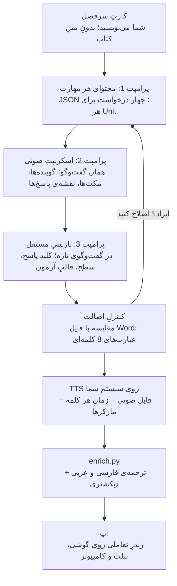

# پرامپت‌های تولیدِ محتوای آموزشیِ اصیل (آیلتس و کنکور)

> **وضعیت:** ایده، در حالِ بررسی (۲۰ اکتبر ۲۰۲۶). هنوز هیچ کدی بر اساسش نوشته نشده است.
> نسخه‌ی زنده‌ی این سند (با نمودار و کامنت): https://claude.ai/code/artifact/2cbbdd9f-2619-4edb-bc3f-21149d76c0b5
> همین فایل در هر دو مخزن هست: `customlayoutgenerator/IDEA-original-content.md` و
> `ielts_assistant/IDEA-original-content.md`. اگر یکی را تغییر دادید، دیگری را هم به‌روز کنید.

## مرزِ کپی‌رایت

بازنویسیِ «بدونِ کم و کاستِ» همان متن‌ها و تمرین‌ها با کلماتِ دیگر هنوز اثرِ اقتباسی (derivative work)
است و مشکلِ کپی‌رایت را حل نمی‌کند. راهِ امن این است: **همان سرفصل‌ها و همان پوشش، با محتوای کاملاً
تازه.** من وکیل نیستم؛ پیش از فروش، با یک وکیلِ مالکیتِ فکری مشورت کنید.

| آزاد است (ایده و چارچوب) | آزاد نیست (بیانِ نویسنده) |
| --- | --- |
| موضوعِ درس (مثلاً «شهرت و رسانه») | متنِ ریدینگ‌ها و اسکریپت‌های صوتی، حتی بازنویسی‌شده |
| مهارت‌ها و انواعِ سؤالِ آیلتس (matching features، flow-chart و…) | جمله‌های تمرین، مثال‌ها، نمونه‌پاسخ‌ها و Tipها |
| نکته‌های دستوری (first conditional، ضمیرها) | ترتیب و انتخابِ دقیقِ تمرین‌ها در یک درس |
| روش‌های رایجِ تدریس و آزمون‌زنی | تصاویر، جدول‌ها، نام و برندِ Mindset |

سه قاعده که در پرامپت‌ها هم گذاشته شده است:

1. **مولد هرگز متنِ کتاب را نمی‌بیند.** ورودیِ پرامپت فقط یک «کارتِ سرفصل» است که خودتان با کلماتِ
   خودتان می‌نویسید: موضوع، مهارت‌ها، گرامر، سطح. چیزی که دیده نشود، کپی هم نمی‌شود.
2. **اصالت با ابزار سنجیده می‌شود، نه با حدس.** خروجی با متنِ کتاب مقایسه می‌شود (هم‌پوشانیِ
   عبارت‌های 8 کلمه‌ای و بیشتر). هر جا هم‌پوشانی بود، بازنویسی می‌شود.
3. **نامِ کتاب و ناشر در محصول نمی‌آید.** «هم‌تراز با Mindset» هم در تبلیغات نه؛ بگویید «منطبق با
   آزمونِ آیلتس، سطحِ B1».

ترجمه‌ها و دیکشنریِ فعلی (روی متنِ Mindset) هم اثرِ اقتباسی‌اند؛ برای استفاده‌ی شخصی بمانند و در نسخه‌ی
فروشی نیایند. مدخل‌های دیکشنری (واژه، تلفظ، معنا، توضیح) به متنِ کتاب وابسته نیستند و در محتوای تازه هم
به کار می‌آیند.

## خطِ تولید

هر Unit از یک کارتِ سرفصل شروع می‌شود و پیش از ساختِ صوت، هم از نظرِ درستی و هم از نظرِ اصالت بررسی
می‌شود. بعد از TTS، همان enrich.py، دیکشنری و اپِ فعلی به کار می‌آیند.



صوت آخر ساخته می‌شود، چون هر اصلاحِ اسکریپت بعد از ضبط یعنی ساختِ دوباره‌ی فایلِ صوتی.

## کارتِ سرفصلِ هر Unit

کارتِ سرفصل تنها ورودیِ همه‌ی پرامپت‌هاست و برای هر Unit حدودِ 10 دقیقه کار می‌برد. فقط موضوع و
هدف‌ها را از فهرستِ کتاب بردارید؛ هیچ جمله یا مثالی از متنِ کتاب نیاورید. نمونه برای Unit 7:

```text
UNIT: 7
THEME: Fame, celebrity and the media
LEVEL: CEFR B1 (IELTS band 4.5–5.5), learners whose first language is Persian or Arabic
READING:
  skills: matching features; identifying the writer's views (Yes/No/Not Given)
  grammar: first conditional (+ should / may / can in the result clause)
WRITING:
  task: Task 2 opinion and advantages/disadvantages essays
  skills: avoiding repetition (synonyms, pronouns); developing a paragraph; specific examples
LISTENING:
  skills: flow-chart completion; predicting the grammatical form of the gap; technical flow-charts
  tracks: 4 (one monologue, one interview, one lecture, one short opinions track)
SPEAKING:
  skills: Part 2 long turn (describe a person); Part 3 question types; tense choice in Part 3
  tracks: 2 model Part 2 answers
EXTRA (optional): pronunciation of -ed endings; collocations with "fame"
```

برای کتاب‌های دیگرِ آیلتس هم همین کارت کافی است؛ فقط LEVEL عوض می‌شود. اگر بخواهید از چارچوبِ Mindset
فاصله‌ی بیشتری بگیرید، موضوع‌ها را از فهرستِ رایجِ موضوعاتِ آیلتس انتخاب کنید و ترتیبِ مهارت‌ها را
خودتان بچینید.

## پرامپت 1: محتوای یک مهارت از یک Unit

هر Unit چهار بار با این پرامپت ساخته می‌شود، یک بار برای هر مهارت (با عوض کردنِ `{SECTION}`)، چون یک
Unitِ کامل در یک پاسخ جا نمی‌شود. خروجی JSON است و به‌جای جدول و فلوچارتِ Word، داده‌ی ساختاریافته
می‌دهد تا اپ آن را روی هر صفحه‌نمایی به شکلِ خودش بکشد.

```text
You are a senior IELTS materials writer and examiner trainer. Write ORIGINAL teaching
material for one skill of one coursebook unit, from the syllabus card below.

SYLLABUS CARD:
{PASTE THE CARD}

SECTION TO WRITE NOW: {SECTION}   (READING | WRITING | LISTENING | SPEAKING | REVIEW)

== Originality (non-negotiable) ==
- Everything is new: texts, people, places, organisations, data, examples, tips, exercise
  items. Do not reproduce, paraphrase or imitate any published coursebook or past exam paper,
  and do not follow the exercise order of any book you may know for this topic.
- Invent fictional people and organisations. Real facts only if well established and
  correct; never put invented quotes in the mouth of a real person.
- No publisher, coursebook or exam-board names in the content.

== Pedagogy ==
- Order inside the section: lead-in -> teach the skill (short explanation + a worked
  example showing the thinking) -> guided practice -> exam-style practice -> answer key with
  explanations -> extension.
- Exam-style practice must match the real IELTS task format exactly: instructions wording
  style, word limits ("NO MORE THAN TWO WORDS"), number of options, answers in text order
  where the real test does so.
- Level: write every learner-facing text at the card's LEVEL; reading passages at the top
  of that level. Instructions in simple English.
- Enrichment beyond a normal coursebook (include all that apply to the section):
  * for every answer: the evidence (quoted line from the passage or transcript) and why
    each wrong option is wrong (distractor analysis);
  * common mistakes of Persian/Arabic speakers for this skill or grammar point;
  * a timing strategy for the exam task;
  * band-descriptor link: which criterion the skill improves and what band 5 vs band 7
    looks like;
  * WRITING: two model answers (band 6 and band 7.5) + examiner-style comments, a planning
    template, a checklist; SPEAKING: model answers at two bands, useful phrases, follow-up
    questions;
  * a vocabulary set of 12-20 items (B1+ words, collocations, phrasal verbs) used in the
    section, each with an example sentence that is different from the text;
  * an easier and a harder variant of the main practice task (label difficulty 1-3).

== Visuals ==
- Never describe a table, flow-chart, map or diagram in prose: output it as data (see
  schema). For a picture that needs drawing, give "image" with an exact description and, if
  it is a simple diagram, an SVG.

== Output: ONLY valid JSON, no text outside it ==
{
  "unit": 7, "section": "READING", "title": "...",
  "objectives": ["..."],
  "blocks": [
    {"type": "heading", "level": 2, "text": "..."},
    {"type": "paragraph", "text": "..."},
    {"type": "teachingBox", "title": "...", "text": "..."},
    {"type": "tip", "text": "..."},
    {"type": "passage", "id": "R1", "title": "...", "paragraphs": [{"label": "A", "text": "..."}]},
    {"type": "audioRef", "trackId": "U7-L1", "purpose": "exercise 3"},
    {"type": "exercise", "id": "E3", "kind": "matchingFeatures | tfng | ynng | mcq | multiSelect |
        gapFill | sentenceCompletion | noteCompletion | tableCompletion | flowChart |
        mapLabelling | matchingHeadings | shortAnswer | open",
     "instructions": "...", "wordLimit": "NO MORE THAN TWO WORDS", "difficulty": 2,
     "options": [{"key": "A", "text": "..."}],
     "items": [{"n": 1, "text": "... ___ ...", "answer": ["...", "accepted variant"],
                "evidence": "exact quote", "explanation": "...",
                "distractors": [{"key": "B", "why": "..."}]}],
     "flowChart": {"nodes": [{"id": "n1", "text": "... ___ ...", "gap": 1}],
                   "edges": [["n1", "n2"]]},
     "table": {"columns": ["..."], "rows": [["...", "___1"]]}},
    {"type": "grammarFocus", "point": "...", "form": "...", "use": "...",
     "examples": ["..."], "commonMistakes": [{"wrong": "...", "right": "...", "why": "..."}]},
    {"type": "modelAnswer", "band": 7.5, "text": "...", "comments": ["..."]},
    {"type": "vocabulary", "items": [{"term": "...", "pos": "...", "cefr": "B2",
     "definition": "...", "example": "..."}]},
    {"type": "image", "description": "...", "svg": "<svg ...>"},
    {"type": "checklist", "items": ["..."]}
  ]
}
- Every exercise "answer" must be checkable against its "evidence".
- Use only the block types above; omit fields that do not apply.
- Length guide: READING 2 passages (450 and 750 words), 25-35 items in total; WRITING 1 full
  lesson + 2 model essays; LISTENING exercises for every track in the card; SPEAKING Part 1,
  2 and 3 practice; REVIEW 20 mixed items + 30 flashcards from the unit vocabulary.
```

برای Listening و Speaking، این پرامپت فقط تمرین‌ها و `audioRef` را می‌سازد. اسکریپتِ همان ترک‌ها با
پرامپت 2 و در همان گفت‌وگو ساخته می‌شود تا پاسخ‌ها با متنِ صوتی یکی باشد.

## پرامپت 2: اسکریپتِ صوتیِ آماده‌ی TTS

این پرامپت را در همان گفت‌وگویی بزنید که بخشِ LISTENING یا SPEAKING ساخته شد، تا متنِ صوتی دقیقاً با
پاسخ‌های تمرین‌ها جور باشد. برچسبِ گوینده در فیلدِ جدا می‌آید، نه داخلِ متن؛ پس مشکلِ «برچسبِ گفته‌نشده»
(A-2) و «عددِ بی‌زمان» (A-3) از ابتدا پیش نمی‌آید.

```text
Now write the audio for every track listed in the SECTION you just wrote (trackIds from its
audioRef blocks). The audio will be produced with a text-to-speech engine that has several
voices; your JSON is the input to that engine.

== Content ==
- Match the exercises exactly: every answer must be heard, spelled exactly as in the answer
  key, and in the same order as the items. Put real IELTS distractors in: a speaker says one
  option, then corrects it; a number is mentioned and then changed; a similar word is said
  near the answer.
- Natural speech: contractions, fillers ("well", "let me think"), self-corrections, a
  question back to the other speaker. Not a written text read aloud.
- Real-test framing for exam practice tracks: a narrator reads the instructions, states the
  pause ("You now have 30 seconds to look at questions 1 to 6") and the pause is in the data.
- Speakers: give each a name, age range, gender and accent. Mix British (most), Australian,
  North American and one non-native but clear speaker across the unit, as the real test does.
- Lengths at B1: Part 1-style dialogue 450-600 words; monologue/lecture 550-750 words;
  speaking model Part 2 answer 220-280 words (about two minutes).
- SPEAKING models: the candidate's answer + (if useful) the examiner's prompt and one
  follow-up question; mark useful phrases.

== Output: ONLY valid JSON ==
{
  "tracks": [{
    "trackId": "U7-L1", "title": "...", "situation": "...",
    "speakers": [{"id": "S1", "name": "...", "role": "narrator|interviewer|student|...",
                  "gender": "female", "age": "30s", "accent": "en-GB",
                  "voiceHint": "warm, mid pitch, moderate pace"}],
    "segments": [
      {"speaker": "S1", "text": "My surname is Chen, that's C-H-E-N.",
       "spoken": "My surname is Chen, that's <spell>CHEN</spell>.",
       "pauseAfterMs": 400, "style": "neutral|cheerful|hesitant"},
      {"speaker": "NARRATOR", "text": "You now have 30 seconds to check your answers.",
       "pauseAfterMs": 30000}
    ],
    "answerMap": [{"exercise": "E3", "item": 1, "segment": 4, "quote": "exact words heard"}],
    "distractorMap": [{"exercise": "E3", "item": 1, "segment": 3, "quote": "..."}]
  }]
}
- "text" is what the learner reads on screen; "spoken" (optional) is what the engine must
  say when it differs: spelled names, numbers, dates, prices, abbreviations ("10.50" ->
  "ten fifty"). Never put speaker names inside "text".
- After the JSON, check silently that every answerMap quote occurs verbatim in its segment.
```

## پرامپت 3: بازبینیِ مستقل

این بازبینی در یک **گفت‌وگوی تازه** انجام می‌شود؛ مدلی که محتوا را نوشته، کارِ خودش را خوب نمی‌سنجد. هر
دو JSON (تمرین و صوت) را با هم بدهید. کنترلِ هم‌پوشانی با متنِ کتاب کارِ این پرامپت نیست؛ با اسکریپتی
روی فایلِ Wordِ خودتان انجام می‌شود (بخشِ آخر).

```text
You are an IELTS examiner and a strict copy editor. Review the unit material below (exercise
JSON and audio JSON). Do not rewrite it. Report problems only.

Check:
1. Answer key: each answer is correct, is the ONLY possible answer, fits the word limit, and
   its evidence quote exists verbatim in the passage or in the audio segment named.
2. Not Given / No logic: the passage really does not say / really contradicts.
3. Audio: every answer is heard in item order; numbers and spellings in "spoken" match
   "text"; distractors do not make a second answer possible.
4. Exam format: instructions, option counts, word limits and order match real IELTS tasks.
5. Level: flag sentences above the target CEFR level and words outside it that are not
   taught in a vocabulary block.
6. Facts: any real-world claim that is wrong or doubtful; any real person given invented
   words.
7. Language: grammar, spelling (British), punctuation, unnatural phrasing.
8. JSON: invalid structure, missing ids, an audioRef with no track, a gap with no answer.
9. Fairness and sensitivity: stereotypes, content unsuitable for teenage learners or for
   learners in Iran and Arab countries.

Output a JSON array, most serious first:
[{"severity": "error|warning", "where": "E3 item 4 / U7-L1 segment 12",
  "problem": "...", "fix": "..."}]
An empty array means no problems found.
```

## پرامپت 4: کتابِ کمک‌کنکوری

همان اصل اینجا هم هست: برنامه‌ی درسی و اصطلاحاتِ کتابِ درسی آزادند، متن، مثال‌ها و شکل‌های کتاب نه.
همه‌ی کتاب‌های کمک‌درسیِ بازار همین کار را می‌کنند: درسنامه و تستِ تازه، با ارجاع به صفحه‌ی کتابِ درسی.
میزانِ مناسب بودنِ هر درس برای این روش یکی نیست:

| درس | مناسبِ محتوای اصیل | چرا |
| --- | --- | --- |
| ریاضی، فیزیک، شیمی | زیاد | مسئله‌ی تازه آزاد است؛ پاسخِ عددی با اجرای کد بررسی می‌شود |
| زبانِ انگلیسی، عربی | زیاد | قواعد و واژگانِ هر درس با جمله‌های تازه، مثلِ آیلتس |
| ادبیاتِ فارسی | متوسط | شعرِ شاعرانِ کلاسیک آزاد است؛ اما انتخاب و شرحِ کتابِ درسی نه |
| زیست‌شناسی | متوسط | تست‌ها به جمله‌های کتاب وابسته‌اند؛ به صفحه ارجاع دهید، جمله را کپی نکنید |
| دین و زندگی | کم | بیشترین وابستگی به متنِ کتاب؛ آیه‌ها آزادند، شرحِ کتاب نه |

کارتِ سرفصل اینجا را هم خودتان می‌نویسید: پایه، رشته، درس، فصل، سالِ چاپِ کتابِ درسی، فهرستِ مفاهیم و
اصطلاحات، و بودجه‌بندیِ تازه‌ی کنکور برای آن فصل (ساختارِ کنکور در سال‌های اخیر عوض شده است؛ این را از
منابعِ رسمی بگیرید).

```text
تو نویسنده‌ی ارشدِ کتابِ کمک‌آموزشی و طراحِ تستِ کنکور در درسِ {درس} هستی. برای فصلِ زیر،
محتوای کاملاً تازه بنویس.

کارتِ سرفصل:
{پایه / رشته / درس / فصل / سالِ چاپِ کتابِ درسی / فهرستِ مفاهیم و اصطلاحات /
 بودجه‌بندیِ کنکور / سطح: پایه | متوسط | پیشرفته}

بخشِ این درخواست: {درسنامه | تستِ مرحله‌ای | آزمونِ جامع | جمع‌بندی}

== اصالت ==
- متن، مثال، شکل و تمرینِ کتابِ درسی و کتاب‌های کمک‌درسیِ دیگر را نه کپی کن، نه بازنویسی.
- اصطلاحات و تعریف‌ها همان اصطلاحاتِ کتابِ درسی‌اند (کنکور با همان‌ها می‌پرسد)، اما توضیح با
  کلماتِ خودت. جایی که جمله‌ی کتاب مهم است، بنویس «بندِ کتابِ درسی، صفحه‌ی ...» و جمله را
  نیاور.
- سؤالِ کنکورِ سال‌های قبل را عیناً نیاور؛ تستِ تازه با همان مهارت بساز.

== دقت ==
- هر پاسخِ عددی را دو بار و به دو روش حساب کن؛ اگر اجرای کد در دسترس است، با کد هم بررسی کن.
- در هر تست فقط یک گزینه درست باشد؛ گزینه‌های غلط از خطاهای واقعیِ دانش‌آموزان ساخته شوند.
- هر مطلبی که مطمئن نیستی در کتابِ درسیِ این سال هست، در فیلدِ "needsCheck" بیاور.

== ساختارِ درسنامه ==
نقشه‌ی مفهومیِ فصل -> برای هر مفهوم: توضیحِ گام‌به‌گام، مثالِ حل‌شده با فکرِ پشتِ هر قدم،
«دامِ تستی»، روشِ تستی/میانبُر با شرطِ کاربردش، ارتباط با فصل‌های دیگر، 3 تا 5 تستِ کوتاهِ
بلافاصله. پایانِ فصل: خطاهای رایج، جمع‌بندیِ یک‌صفحه‌ای، 30 فلش‌کارت.

== تست‌ها ==
چهارگزینه‌ای، با سطحِ دشواری 1 تا 4 (4 = هم‌سطحِ کنکور)، زمانِ پیشنهادی، پاسخِ تشریحی، دلیلِ غلط
بودنِ هر گزینه، و برچسبِ مفهوم (برای گزارشِ نقاطِ ضعفِ دانش‌آموز در اپ).

== خروجی: فقط JSONِ معتبر ==
{"grade": 11, "subject": "...", "chapter": "...", "section": "...",
 "blocks": [
  {"type": "conceptMap", "nodes": [{"id": "c1", "text": "..."}], "edges": [["c1", "c2", "برچسب"]]},
  {"type": "heading", "level": 2, "text": "..."},
  {"type": "paragraph", "text": "... $\\frac{a}{b}$ ..."},
  {"type": "formula", "latex": "...", "meaning": "..."},
  {"type": "workedExample", "problem": "...", "steps": [{"do": "...", "why": "..."}], "answer": "..."},
  {"type": "pitfall", "text": "..."},
  {"type": "shortcut", "text": "...", "whenItWorks": "..."},
  {"type": "textbookRef", "page": 45, "note": "بندِ مربوط را در کتاب بخوانید"},
  {"type": "figure", "description": "...", "svg": "<svg ...>"},
  {"type": "mcq", "id": "T1", "difficulty": 3, "seconds": 75, "concept": "c2",
   "stem": "...", "options": ["...", "...", "...", "..."], "answer": 2,
   "solution": "...", "whyWrong": {"1": "...", "3": "...", "4": "..."}},
  {"type": "flashcard", "front": "...", "back": "..."}
 ],
 "needsCheck": ["..."]}
- فرمول‌ها LaTeX، داخلِ متن با $...$. معادله‌ی شیمیایی با اندیسِ ساده‌ٔ LaTeX
  (H_2O)، نه بسته‌های خاص.
- از نمودار و شکلِ ساده SVG بده؛ برای شکلِ پیچیده فقط descriptionِ دقیق.
```

بازبینیِ کتابِ کنکوری هم با پرامپت 3 است، با این تغییرها: به‌جای IELTS examiner «معلمِ باتجربه‌ی کنکور»،
و حلِ دوباره‌ی هر تست بدونِ دیدنِ پاسخ. با این حال، برای محصولی که فروخته می‌شود، بازبینیِ یک معلمِ همان
درس لازم است؛ مدل در تست‌های دشوارِ فیزیک و شیمی اشتباه می‌کند.

## نکته‌های اجرایی و ریسک‌ها

**صوت.** Claude خودش فایلِ صوتی نمی‌سازد؛ JSONِ پرامپت 2 به یک سرویسِ TTS داده می‌شود. محیطِ Claude هم به
این سرویس‌ها دسترسیِ شبکه ندارد، پس اسکریپتِ تبدیل روی سیستمِ خودتان اجرا می‌شود. مزیتِ بزرگ: بعضی
سرویس‌ها زمانِ هر کلمه را هم برمی‌گردانند و مارکرها بدونِ align_engine و بازبینیِ دستی ساخته می‌شوند.

| سرویس | زمانِ کلمه‌به‌کلمه | ملاحظه |
| --- | --- | --- |
| Azure AI Speech | دارد (WordBoundary) | صداهای بریتانیایی و استرالیایی، SSML برای مکث و هجی |
| ElevenLabs | دارد (خروجیِ with-timestamps) | طبیعی‌ترین صدا برای گفت‌وگو |
| Google Cloud TTS | فقط در نشانه‌های SSML | باید پشتِ هر کلمه mark گذاشت |
| سرویسِ بی‌زمان‌بندی | ندارد | مارکرها با align_engineِ فعلی |

شرایطِ استفاده‌ی تجاری از صدای تولیدشده و قیمتِ هر سرویس را پیش از انتخاب بخوانید. ترک‌های آزمونِ کامل
شاید با صداپیشه‌ی انسانی طبیعی‌تر باشند؛ اسکریپت برای هر دو راه یکی است.

**اپ.** محتوای تازه دیگر از Word و CustomLayoutGenerator رد نمی‌شود و مستقیم JSON است. این کارها در
فلاتر لازم است:

- رندررِ هر `kind`ِ تمرین به‌صورتِ ویجتِ تعاملی (انتخاب، تایپ، بکش‌ورهاکن)، با نمره‌دهیِ خودکار از روی
  `answer`.
- فلوچارت از `nodes`/`edges`: عمودی روی گوشی، افقی روی تبلت و دسکتاپ. جدول روی گوشی به کارت تبدیل
  می‌شود.
- SVG با `flutter_svg` و LaTeX با یک پکیجِ فرمول مثلِ `flutter_math_fork`.
- تبدیلِ بلوک‌های متنی به پاراگراف‌های فعلی، تا enrich.py و دیکشنری و ترجمه‌ی فارسی و عربی بدونِ تغییر
  به کار بروند.

سؤالِ باز: برای محتوای تازه رندررهای JSONِ جدید در فلاتر بسازیم، یا همه‌چیز را به مدلِ پاراگرافیِ فعلی
تبدیل کنیم؟

**کنترلِ اصالت.** اسکریپتی که هر خروجی را با فایل‌های Wordِ کتاب مقایسه کند و هر عبارتِ مشترکِ 8
کلمه‌ای یا بیشتر را گزارش دهد، نوشتنی است (کنارِ `tools/enrichment/compare_scripts.py`).

**حجمِ کار.** هر Unit حدودِ 8 درخواست دارد (4 محتوا، 2 صوت، 2 بازبینی)؛ یک کتابِ 8 واحدی حدودِ 64
درخواست، به‌علاوهٔ بازبینیِ انسانی.

**ریسک‌های اصلی:**

- خطای محتواییِ مدل، به‌ویژه در مسئله‌های دشوار و کلیدِ پاسخ. بازبینیِ مستقل و معلمِ انسانی جایگزین
  ندارد.
- شباهتِ ناخواسته به کتاب‌های موجود. کنترلِ اصالت برای همین است.
- برای کتابِ کنکوری: بررسی کنید برای فروش به‌عنوانِ کمک‌آموزشی مجوزی از آموزش و پرورش لازم است یا نه؛
  این را از منبعِ رسمی بپرسید.
